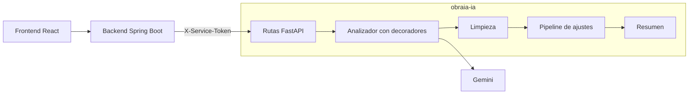

# obraia-ia


Servicio de inteligencia artificial de **ObraIA**. Recibe el plano de una obra (PDF o imagen), lo lee con un modelo de visión (Gemini) y devuelve las medidas de cada elemento: cimientos, columnas, vigas, losas, muros, pisos y cubierta.
Proyecto final de Patrones de Software: Kevin Basante y Arley Riascos.

Este servicio no tiene base de datos ni usuarios: solo lo llama el backend (`obraia-backend`), que guarda las medidas y las compara con las que se ingresan a mano.



## Tecnologías

- Python 3.11 + FastAPI
- Uvicorn como servidor
- Google Gen AI SDK (`google-genai`) para llamar a Gemini
- Pydantic para validar los datos
- Pytest para las pruebas
- Render para el despliegue

## Requisitos

- Python 3.11 o superior
- Git
- Una clave de Gemini de [Google AI Studio](https://aistudio.google.com/apikey) (opcional: sin clave se puede usar el analizador `fake`)

## Instalación

```bash
git clone https://github.com/Kevin-Basante/obraia-ia.git
cd obraia-ia
python -m venv venv
```

Activar el entorno virtual:

| Windows (PowerShell)        | Mac / Linux               |
| --------------------------- | ------------------------- |
| `.\venv\Scripts\Activate.ps1` | `source venv/bin/activate` |

Instalar las dependencias (incluye las de pruebas):

```bash
pip install -r requirements-dev.txt
```

## Variables de entorno

1. Copia `.env.example` y renómbralo a `.env`.
2. Completa los valores.

El archivo `.env` está en `.gitignore` y **nunca** se sube a GitHub. La clave de Gemini tampoco se pega en el chat ni en capturas.

| Variable         | Descripción                                                                  |
| ---------------- | ---------------------------------------------------------------------------- |
| `ANALYZER`       | `gemini` lee el plano con Gemini (por defecto); `fake` devuelve medidas de ejemplo sin IA |
| `GEMINI_API_KEY` | Clave de Google AI Studio (solo con `ANALYZER=gemini`)                       |
| `GEMINI_MODEL`   | Modelo de Gemini que lee los planos (por defecto `gemini-3.5-flash`)         |
| `GEMINI_FALLBACK_MODEL` | Modelo de respaldo cuando el principal está saturado (por defecto `gemini-3.5-flash-lite`; vacío lo desactiva) |
| `GEMINI_RETRIES` | Reintentos de cada modelo cuando Gemini responde que está saturado (por defecto 2) |
| `SERVICE_TOKEN`  | Clave compartida con el backend; llega en el encabezado `X-Service-Token`    |
| `MAX_FILE_MB`    | Tamaño máximo del plano en MB (por defecto 10)                               |
| `MAX_PDF_PAGES`  | Páginas máximas de un PDF (por defecto 10)                                    |
| `MAX_CONCURRENT_ANALYSES` | Análisis al mismo tiempo; los demás reciben `503 ANALYZER_BUSY` (por defecto 2) |
| `PORT`           | Puerto del servidor (Render lo asigna solo)                                   |

## Comandos

| Comando                                  | Qué hace                                         |
| ---------------------------------------- | ------------------------------------------------ |
| `uvicorn app.main:app --reload`          | Inicia el servidor en `http://localhost:8000`    |
| `pytest`                                 | Ejecuta las pruebas (no llaman a Gemini)         |
| `pytest --cov`                           | Pruebas con el reporte de cobertura              |
| `ruff check .`                           | Revisa errores y el orden de los imports         |
| `ruff format .`                          | Da formato al código                             |

La documentación interactiva (Swagger) queda en `http://localhost:8000/docs`.

## Endpoints

| Método | Ruta                          | Token | Qué hace                                             |
| ------ | ----------------------------- | ----- | ---------------------------------------------------- |
| GET    | `/health`                     | No    | Estado del servicio; `ready` dice si puede analizar   |
| POST   | `/api/v1/blueprints/analyze`  | Sí    | Lee un plano y devuelve las medidas de sus elementos  |
| GET    | `/api/v1/elements`            | Sí    | Tipos de elemento, medidas que necesita cada uno y su unidad |
| GET    | `/docs`                       | No    | Documentación Swagger                                |

`GET /health` responde:

```json
{ "status": "UP", "analyzer": "gemini", "model": "gemini-3.5-flash", "ready": true, "version": "1.0.0", "uptime_seconds": 532 }
```

`POST /api/v1/blueprints/analyze` recibe un formulario `multipart/form-data`:

| Campo    | Tipo    | Descripción                                   |
| -------- | ------- | --------------------------------------------- |
| `file`   | archivo | Plano en PDF, PNG, JPG o WEBP                 |
| `floors` | número  | Pisos de la obra: 1 o 2 (por defecto 1)       |

Respuesta (200):

```json
{
  "measurements": [
    {
      "element_type": "wall",
      "floor_number": 1,
      "length_m": 36.0,
      "width_m": null,
      "height_m": 2.4,
      "quantity": 1,
      "notes": "Muros de fachada"
    }
  ],
  "warnings": ["La escala del plano no es visible"],
  "discarded": 0,
  "merged": 0,
  "summary": [
    { "element_type": "wall", "rows": 1, "pieces": 1, "total": 86.4, "unit": "m2" }
  ],
  "model": "gemini-3.5-flash",
  "elapsed_ms": 8421
}
```

- `merged`: filas repetidas que se unieron en una sola (se suman sus cantidades).
- `summary`: totales por tipo de elemento. `total` es volumen (m3) para cimientos, columnas, vigas y losas, y superficie (m2) para muros, pisos y cubierta.

Errores, con la misma forma que el backend (`{ "error": { "code", "message" } }`):

| Código HTTP | `code`                  | Cuándo                                          |
| ----------- | ----------------------- | ----------------------------------------------- |
| 400         | `EMPTY_FILE`            | El archivo está vacío                           |
| 400         | `UNSUPPORTED_FILE`      | No es PDF, PNG, JPG ni WEBP                     |
| 400         | `PDF_TOO_MANY_PAGES`    | El PDF tiene más páginas que `MAX_PDF_PAGES`     |
| 400         | `VALIDATION_ERROR`      | Falta el archivo o `floors` no es 1 o 2         |
| 401         | `INVALID_SERVICE_TOKEN` | Falta `X-Service-Token` o no coincide           |
| 413         | `FILE_TOO_LARGE`        | El plano pasa de `MAX_FILE_MB`                  |
| 502         | `ANALYZER_FAILED`       | Gemini rechazó la petición o su respuesta no se pudo leer |
| 503         | `ANALYZER_NOT_READY`    | Falta `GEMINI_API_KEY`                          |
| 503         | `SERVICE_NOT_CONFIGURED`| Falta `SERVICE_TOKEN` en el servidor            |
| 503         | `ANALYZER_BUSY`         | Gemini sigue saturado después de los reintentos y del modelo de respaldo, o ya hay `MAX_CONCURRENT_ANALYSES` análisis en curso; se puede intentar más tarde |
| 404         | `NOT_FOUND`             | La ruta no existe                               |
| 405         | `METHOD_NOT_ALLOWED`    | La ruta existe pero no con ese método           |
| 500         | `INTERNAL_ERROR`        | Error inesperado; el detalle solo queda en los logs |

## Cómo se lee un plano

1. **Tipo de archivo:** se reconoce por sus primeros bytes, no por el nombre, así que un `.pdf` falso se rechaza. Un PDF con más de `MAX_PDF_PAGES` páginas también se rechaza.
2. **Modelo:** el plano y unas instrucciones (`app/prompt.py`) se envían a Gemini, que responde en JSON con la forma de `RawAnalysis`. La temperatura es 0 para que el mismo plano dé el mismo resultado.
   - `GeminiAnalyzer` hace una sola llamada. Los reintentos y el modelo de respaldo se agregan alrededor con decoradores (`app/analyzers/retrying.py` y `fallback.py`), armados en `factory.py`.
   - Si Gemini responde que está saturado (429, 500, 503 o 504), `RetryingAnalyzer` reintenta hasta `GEMINI_RETRIES` veces, esperando 2 s, luego 4 s.
   - Si el modelo principal sigue saturado, `FallbackAnalyzer` prueba `GEMINI_FALLBACK_MODEL`, y la respuesta trae una advertencia que lo dice.
   - Si los dos siguen saturados, se responde `503 ANALYZER_BUSY`. Cada intento queda en los logs de Render.
3. **Limpieza** (`app/cleaning.py`): cada elemento se revisa antes de devolverlo.
   - Solo se aceptan los 7 tipos del backend (también en plural, como `walls`).
   - Cada tipo guarda solo las medidas que necesita: volumen (largo, ancho y alto) para cimientos, columnas, vigas y losas; largo y alto para muros; largo y ancho para pisos y cubierta.
   - Las medidas se redondean a centímetros. Un elemento sin una medida obligatoria, con valores fuera de rango o en un piso que la obra no tiene se descarta y se cuenta en `discarded`.
4. **Ajustes finales** (`app/postprocess/`): una cadena de pasos que se ejecutan en orden.
   - `MergeDuplicates` une las filas con el mismo elemento, piso y medidas, y suma sus cantidades.
   - `PlausibilityCheck` agrega una advertencia cuando una medida es rara para una casa (por ejemplo, un muro de más de 6 m de alto). La fila se conserva para que el usuario la revise.
   - `SortByFloorAndElement` ordena por piso y luego en el orden de construcción: cimientos, columnas, vigas, losas, muros, pisos y cubierta.
5. **Respuesta:** las medidas válidas, las advertencias, los totales por elemento, el modelo usado y el tiempo que tardó.

## Logs y request ID

- Cada petición recibe un código (`X-Request-ID`). Si el backend envía uno válido, se usa el mismo; si no, se crea uno nuevo. Siempre vuelve en la respuesta.
- Cada línea de log muestra ese código: `INFO [3f2a…] app.access: POST /api/v1/blueprints/analyze -> 200 in 8421 ms`. Así se encuentran juntas todas las líneas de un análisis en los logs de Render.
- `/health` no se escribe en el log de accesos porque Render lo llama seguido.

## Patrones de diseño

| Patrón             | Dónde                                   | Para qué                                                         |
| ------------------ | --------------------------------------- | ---------------------------------------------------------------- |
| Strategy           | `app/analyzers/` (`BlueprintAnalyzer`)  | Cambiar entre Gemini y el analizador de ejemplo sin tocar la ruta |
| Factory            | `app/analyzers/factory.py`              | Crear el analizador que dice `ANALYZER`                          |
| Decorator          | `app/analyzers/retrying.py`, `fallback.py` | Agregar reintentos y modelo de respaldo sin cambiar `GeminiAnalyzer` |
| Chain of Responsibility | `app/postprocess/` (`Pipeline`)    | Pasar las medidas por varios pasos; agregar uno no cambia los demás |
| Inyección de dependencias | `Depends` de FastAPI             | Las pruebas reemplazan el analizador y la configuración          |
| DTO                | `app/schemas.py`                        | Formas de los datos que entran y salen del servicio              |

En el backend, el **Adapter** (`AiServiceAdapter`) traduce las respuestas de este servicio al dominio de Java y el **Proxy** (`AiServiceProxy`) controla el acceso, guarda en caché los análisis y limita cuántos se hacen por obra.

## Pruebas

- 151 pruebas con pytest; ninguna llama a Gemini (se usan analizadores simulados).
- Cobertura cercana al 100 % de las líneas de `app/` (`pytest --cov`).
- GitHub Actions (`.github/workflows/tests.yml`) revisa el estilo con ruff y corre las pruebas en cada push a `main`.

| Archivo                     | Qué prueba                                         |
| --------------------------- | -------------------------------------------------- |
| `test_analysis.py`          | La ruta de análisis, sus errores y límites          |
| `test_gemini.py`            | La llamada a Gemini y la lectura de su respuesta    |
| `test_decorators.py`        | Reintentos y modelo de respaldo                     |
| `test_cleaning.py`          | Limpieza de las medidas                             |
| `test_postprocess.py`       | Unión de filas, medidas raras y orden               |
| `test_quantities.py`, `test_summary.py` | Volúmenes, superficies y totales        |
| `test_middleware.py`, `test_request_id.py`, `test_logging_setup.py` | Request ID y logs |
| `test_errors.py`            | Forma de los errores 400, 404, 405 y 500            |

## Estructura

```text
app/
├── __init__.py          # Versión del servicio
├── main.py              # Crea la aplicación y registra las rutas
├── config.py            # Variables de entorno
├── middleware.py        # Request ID y log de accesos
├── request_id.py        # Código de cada petición
├── logging_setup.py     # Formato de los logs
├── limiter.py           # Análisis al mismo tiempo
├── pdf_pages.py         # Cuenta las páginas de un PDF
├── quantities.py        # Volumen o superficie de cada medida
├── summary.py           # Totales por elemento
├── uptime.py            # Tiempo encendido
├── errors.py            # Errores con la forma { error: { code, message } }
├── security.py          # Revisa el encabezado X-Service-Token
├── elements.py          # Tipos de elemento y medidas que necesita cada uno
├── file_types.py        # Reconoce PDF, PNG, JPG y WEBP
├── schemas.py           # Modelos de entrada y salida (Pydantic)
├── prompt.py            # Instrucciones para el modelo
├── cleaning.py          # Revisa y limpia las medidas del modelo
├── analyzers/
│   ├── base.py          # Interfaz BlueprintAnalyzer (Strategy)
│   ├── gemini.py        # Lee el plano con Gemini (una llamada)
│   ├── retrying.py      # Decorador: reintentos
│   ├── fallback.py      # Decorador: modelo de respaldo
│   ├── fake.py          # Medidas de ejemplo, sin IA
│   └── factory.py       # Elige el analizador y lo envuelve
├── postprocess/
│   ├── base.py          # Pipeline y Report
│   ├── merge.py         # Une filas repetidas
│   ├── plausibility.py  # Advierte medidas raras
│   └── sorting.py       # Ordena por piso y elemento
└── routers/
    ├── health.py        # GET /health
    ├── analysis.py      # POST /api/v1/blueprints/analyze
    └── elements.py      # GET /api/v1/elements
tests/                   # Pruebas con pytest (Gemini simulado)
.github/workflows/       # Pruebas automáticas en GitHub Actions
```

## Despliegue en Render

1. En Render: **New → Web Service** y conecta el repositorio `obraia-ia`.
2. Configuración:
   - **Runtime:** Python 3
   - **Build Command:** `pip install -r requirements.txt`
   - **Start Command:** `uvicorn app.main:app --host 0.0.0.0 --port $PORT`
   - **Instance Type:** Free
   - **Health Check Path:** `/health`
3. En **Environment** agrega `ANALYZER=gemini`, `GEMINI_API_KEY` y `SERVICE_TOKEN` (un texto aleatorio largo). El mismo `SERVICE_TOKEN` va en el backend como `AI_SERVICE_TOKEN`.
4. La versión de Python sale del archivo `.python-version`.

El plan gratuito de Render apaga el servicio tras 15 minutos sin uso; la primera llamada después puede tardar cerca de un minuto mientras arranca.

## Equipo y responsabilidades

| Integrante    | Responsabilidad                                                    |
| ------------- | ------------------------------------------------------------------ |
| Kevin Basante | Servicio de IA (este repositorio), backend y base de datos         |
| Arley Riascos | Frontend (`obraia-frontend`)                                       |

Los dos trabajan juntos en el diseño y revisan el avance de los tres repositorios.

## Convenciones

- Código, comentarios, rutas y claves JSON en inglés; documentación en español.
- Commits con prefijo según el tipo de cambio: `feat:`, `fix:`, `docs:`, `chore:`, `test:`.
- Las claves (`GEMINI_API_KEY`, `SERVICE_TOKEN`) solo van en `.env` o en Render, nunca en GitHub.
